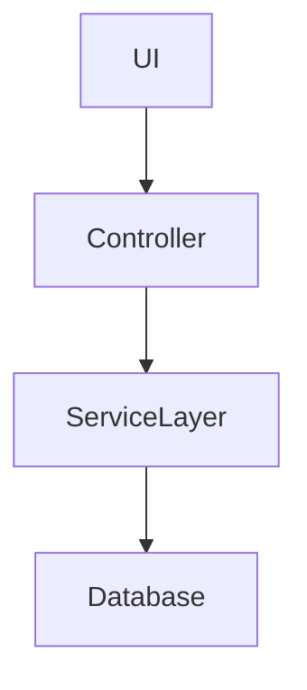

# Technical Design Document (TDD): [Feature / Project Name]

**Document Status:** [Draft / Under Review / Approved]
**Author:** [Name]
**Date:** [YYYY-MM-DD]
**Related PRD:** [Link to PRD]

## 1. Executive Summary
*A brief technical summary of how we intend to solve the problem defined in the PRD.*

---

## 2. System Architecture
### 2.1 High-Level Design
*Describe the architecture pattern (e.g., Microservices, Event-Driven, MVC). Consider embedding a Mermaid.js diagram here to show how components interact.*



### 2.2 Tech Stack Selection
* **Frontend:** [e.g., React / Streamlit]
* **Backend:** [e.g., Node.js / Python FastAPI]
* **Database:** [e.g., PostgreSQL]

---

## 3. Data Models & Database Schema
*Map out the exact data structures and their relationships.*

### 3.1 `[Model Name, e.g., InvestmentBrick]`
| Field Name | Type | Constraints | Description |
|------------|------|-------------|-------------|
| id | UUID | Primary Key | Unique identifier. |
| price | Float| > 0 | Total purchasing price. |
| type | Enum | ['Studio', 'T2'] | Category of the property. |

---

## 4. API Contracts & Interfaces
*Define how systems will communicate. If this is a REST API or internal class method, lay it out.*

### 4.1 Endpoint: `POST /api/v1/simulate`
**Description:** Triggers the portfolio calculation engine.
**Request Payload:**
```json
{
  "budget": 50000,
  "target_dscr": 1.15
}
```
**Response (200 OK):**
```json
{
  "results": [
    { "portfolio_id": 123, "irr": 0.08 }
  ]
}
```
**Error Codes:**
* `400 Bad Request`: If budget < 0.

---

## 5. Core Algorithms & Logic
*For complex backend mechanics, explain the exact algorithm you will implement.*
* **Step 1:** Fetch property archetypes.
* **Step 2:** Execute a greedy algorithm incrementing down payments by €1,000 until DSCR >= 1.0.
* **Step 3:** Pass results through a Pareto dominance filter comparing IRR vs Risk.

---

## 6. Security, Edge Cases & Error Handling
* **Edge Case:** What happens if the API times out? (Fallback to cached results).
* **Error Handling:** How will errors be bubbled up to the UI?
* **Security:** How are we preventing SQL injection or protecting user sessions?
