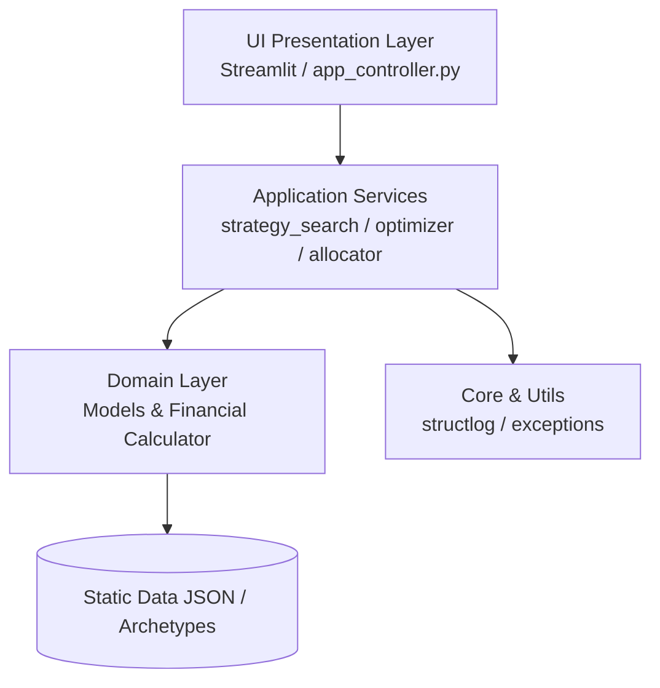

# Technical Design Document (TDD): App Immo Engine

**Document Status:** Draft
**Author:** AI Agent
**Date:** 2026-03-06
**Related PRD:** [Unified Specification Document](docs/automated_analysis/unified_specification.md)

## 1. Executive Summary
App Immo is a sophisticated financial modeling simulation engine designed to compute and optimize real estate property portfolio strategies in France. It evaluates long-term cash flow capabilities, taxing mechanisms (including LMNP and micro-bic conditions), loan amortizations, and market scoring heuristics. The primary goal is to provide end-users with the most statistically efficient multi-property combinations based on Pareto dominance (maximizing Internal Rate of Return (IRR) while satisfying Debt Service Coverage Ratio (DSCR) restrictions).

---

## 2. System Architecture
### 2.1 High-Level Design
The system employs a Modular Monolith architecture relying strictly on Domain-Driven Design (DDD). It logically segregates into Domain Models, Application Services (Engine calculations), Core/Utilities infrastructure, and a discrete UI Presentation layer decoupled from inner logic.

- **App Entry (`app.py`):** Initializes global state and loops.
- **UI (`ui/`):** View components managing isolated renders and the central `app_controller.py` bridging domain services to the Streamlit session state.
- **Application Services (`application/services/`):** Heavy lifting components encompassing complex simulation logic, Exhaustive/Genetic optimizations, and dynamic capital allocation.
- **Domain (`domain/`):** Pure state models constrained by Pydantic, incorporating purely stateless financial calculators ensuring idempotency.
- **Core (`core/`):** Unifies exceptions, deterministic canonical formulas (`glossary.py`), logging setups (`structlog`), and debugging telemetry.

### 2.2 Tech Stack Selection
* **Frontend / Internal UI:** Streamlit (Python-based reactive rendering interface)
* **Backend Runtime:** Python 3.10+
* **Data Validations & Typing:** Pydantic v2 (`BaseModel`, `@computed_field`)
* **Financial & Data Computation:** `numpy`, `numpy_financial`, `pandas`
* **Charting:** Plotly (`plotly.express`, `plotly.graph_objects`)
* **Logging/Observability:** `structlog` (Terminal + JSON file logs)
* **Testing & Linting:** `pytest` + `pytest-cov`, `mypy` (strict), `ruff`

---

## 3. Data Models & Database Schema
The system does not rely on a continuous relational database for configuration loops, but utilizes static JSON references and strict Pydantic structures for in-memory modeling and validation.

### 3.1 `ArchetypeV2`
| Field Name | Type | Constraints | Description |
|------------|------|-------------|-------------|
| qualitative parameters | Float/String | Pre-validated | Base property markers (surface, price/m², DPE, tension). Used for heuristic grading pre-computation. |

### 3.2 `InvestmentBrick`
| Field Name | Type | Constraints | Description |
|------------|------|-------------|-------------|
| cout_total | Computed Float | > 0 | Evaluates base purchase cost alongside added transaction and renovation overlays. |
| pmt_total | Computed Float | >= 0 | Total monthly loan payment (P&I + insurance): `pmt_principal_interet + pmt_assurance`. |
| cash_flow_mensuel_initial | Computed Float | Derived | Represents the gross operating margin early calculations predict based on pure ratios. |

### 3.3 `PortfolioStrategy`
| Field Name | Type | Constraints | Description |
|------------|------|-------------|-------------|
| details | List[Dict] | >= 1 Item | Aggregated list of property brick data dictionaries (serialized via `model_dump()`). Not typed as `List[InvestmentBrick]` — strategies pass serialized dicts for downstream flexibility. |
| cash_flow_final | Float | Derived | Net monthly cash flow after allocation (target proximity metric). |
| balanced_score | Float | Derived | Combined finance + qualitative score (0–100). |
| taxonomy | String\|None | Optional | Strategy type label: `Optimisé`, `Patrimonial`, `Mix`. |

---

## 4. API Contracts & Interfaces
Although structured as a standalone Streamlit web application, strict internal interfaces handle request/response boundaries.

### 4.1 Orchestration: `run_strategy_search()`
**Description:** Internal domain orchestration endpoint triggering Exhaustive or Genetic solver algorithms based on scale constraints.
**Input Payload (Internal Model Types):**
- Flat keyword arguments: `archetypes` (list of dicts), `fin_config` (FinancingConfig), `op_config` (OperatingConfig), `apport` (float), `cf_cible` (float), `tolerance` (float), `qual_weight` (float), `mode_cf` (str), `eval_params` (dict), `horizon_years` (int), `top_n` (int), `progress_callback` (callable|None).
- Note: `SimulationParams` is a domain model defined in `src/domain/models/strategy.py` but is **not** used directly as the input type for `run_strategy_search()`. Parameters are passed as a plain dict (`eval_params`) and expanded internally by `EvaluationParams.from_dict()`.
**Operations:**
- Triggers the appropriate solver based on scope. The `ExhaustiveOptimizer` distributes computational tasks via localized multi-threaded execution pools (`concurrent.futures`), while the `GeneticOptimizer` evaluates individuals sequentially without thread pooling to respect stream-based UI limitations.
- Updates dynamic telemetry references (`SearchProgress`) decoupled from primary render loops.
**Return:** 
- Ordered `list[dict]` of ranked strategies. Each dict contains simulation summary metrics (`tri_annuel`, `dscr_y1`, `enrich_net`, `cash_flow_final`, `fitness`, `balanced_score`). A separate `StrategyResult` Pydantic model exists in `src/domain/models/strategy.py` for typed deep-dive results.

### 4.2 Application Calculator Interfaces
- `PortfolioAllocator.allocate()`: Iteratively increases individual property down payments (starting at minimum `apport_min`) to satisfy a **cash flow target** (`target_cf ± tolerance`), not a DSCR threshold. Uses an efficiency-sorted greedy loop with up to 5 refinement passes (coarse → fine step sizing). The `MAX_EXTRA_APPORT_PCT` cap (default `0.95`, env-configurable) prevents near-zero residual loans.
- `StrategyFinder.find_strategies()`: Analyzes vast arrays of generation loops, resolving multidimensional fitness comparisons using Pareto optimizations to filter subsets.

---

## 5. Core Algorithms & Logic
The computational backend executes millions of financial combinations via the following algorithm sequence:
* **Step 1: Combination Synthesis (Optimizer):** Leverages an iterator-based `ExhaustiveOptimizer` (for manageable bounds, below `THRESHOLD_EXHAUSTIVE = 1,000,000` theoretical combinations after pruning) or a `GeneticOptimizer` utilizing evolutionary structures (tournament selection, elitism, chromosomal crossover, mutation with stagnation early-stop) when configuration volume exceeds this threshold.
* **Step 2: Dynamic Allocation (`allocator.py`):** For every viable combination passing base boundary checks, the engine incrementally increases minimum down payments (starting at the lowest boundary limits) until the portfolio strictly adheres to a globally safe DSCR threshold.
* **Step 3: Long-term Cashflow Simulation (`simulation.py`):** Pushes data forward through 25-year schedules iterating static variables (taxes like LMNP amortizations) alongside loan rate maturity tracking and property depreciation impacts.
* **Step 4: Pareto Front Discarding (`strategy_finder.py`):** Remaining mathematically valid combinations enter multidimensional dominance sorting (maximizing IRR vs Minimizing Capital Requirements). Deep filters slice suboptimal models from processing rendering loops prior to UI feedback.

---

## 6. Security, Edge Cases & Error Handling
* **Error Isolation (`src/core/exceptions.py`):** Custom exception hierarchy under `AppImmoError`: `DataLoadError`, `ArchetypeError` (data errors); `SimulationError`, `AmortizationError`, `AllocationError` (calculation errors); `StrategyError`, `NoStrategiesFoundError` (strategy errors); `InvalidParameterError`, `ConfigurationError` (config errors). These isolate backend anomalies from causing hard frontend crashes.
* **Mathematical Boundary Edges:** Must protect against negative inputs driving loops infinitely. Strict constraints on structural arrays containing 0 capital limits missing strict validation arrays are prevented via the initial Pydantic schema ingestors.
* **Telemetry Leakage:** The auto-debug module `src/utils/debug.py` collects and saves execution snapshots to `results/debug_context_<timestamp>.json` after every strategy search. Ensure external deployment constraints strip or gate this file-write behaviour to prevent internal config state from leaking in production.
* **Evolutionary Degradation Cap:** Implemented circuit breakers govern Genetic optimization variants to limit computational drift during `Tournament` and `Generational` phase boundaries, yielding suboptimal fallback arrays rather than freezing processing threads.
